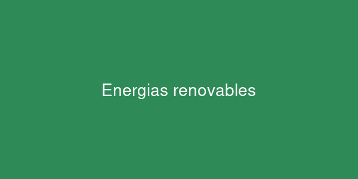

# Energías renovables: el futuro energético

## Una introducción práctica

Las energías renovables proceden de fuentes **inagotables a escala humana**, como el sol, el viento o el agua. Su uso es *clave* para reducir las emisiones de CO₂ y frenar el cambio climático. Por ejemplo, un script puede calcular la producción con la función `calcular_produccion()`.



## Ejemplo de código

Cálculo sencillo de la energía generada por un panel solar (en kWh):

```python
def energia_solar(potencia_kw, horas_sol, rendimiento=0.85):
    """Devuelve la energía diaria generada en kWh."""
    return potencia_kw * horas_sol * rendimiento

# Panel de 5 kW con 6 horas de sol al día
print(energia_solar(5, 6))  # 25.5
```

## Tipos de energía renovable

Lista desordenada:

- Solar
- Eólica
- Hidráulica
- Geotérmica
- Biomasa

Pasos para instalar paneles solares en una vivienda (lista ordenada):

1. Estudiar el consumo eléctrico del hogar.
2. Solicitar un presupuesto a una empresa instaladora.
3. Tramitar los permisos y subvenciones.
4. Instalar los paneles y el inversor.
5. Conectar a la red y monitorizar la producción.

## Comparativa

| Fuente     | Recurso principal  | Ventaja destacada                 |
|------------|--------------------|-----------------------------------|
| Solar      | Radiación del sol  | Fácil de instalar en tejados      |
| Eólica     | Viento             | Alta producción en zonas costeras |
| Hidráulica | Agua en movimiento | Producción estable y almacenable  |

## Enlaces

- Más información en [Wikipedia: Energía renovable](https://es.wikipedia.org/wiki/Energ%C3%ADa_renovable)
- Ampliación del tema en el [fichero de detalles](docs/detalles.md)

## Imagen externa (Wikimedia Commons)


